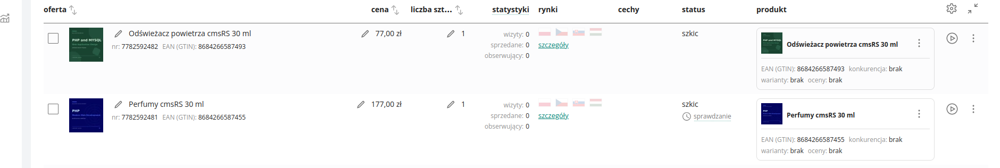

# Allegro – integracja i import danych

Projekt służy do integracji z API Allegro. Jego celem jest pobieranie danych, przetwarzanie ich oraz tworzenie produktów w Allegro.

## 1. Konfiguracja Allegro OAuth

Po stronie Allegro należy utworzyć aplikację OAuth 2.0 z wykorzystaniem mechanizmu:

**Device Authorization Grant (Device Flow)**

Jest to autoryzacja urządzenia za pomocą `device_code`.

Ten sposób autoryzacji:
- nie wymaga uruchamiania lokalnego serwera HTTP,
- nie wymaga konfigurowania `redirect_uri`,
- umożliwia autoryzację bezpośrednio z poziomu skryptu PHP.

## 2. Autoryzacja i pobranie tokenów

Po utworzeniu aplikacji Allegro należy uzupełnić dane dostępowe w pliku konfiguracyjnym `.env`.

Następnie uruchomić skrypt:

```bash
php ./src/cli/authorize_device.php
```

Skrypt przeprowadzi proces autoryzacji:
1. Połączy się z Allegro.
2. Pobierze `device_code` oraz `user_code`.
3. Wyświetli adres strony i kod autoryzacyjny.
4. Umożliwi zaakceptowanie dostępu do aplikacji.
5. Będzie oczekiwał na potwierdzenie autoryzacji.
6. Pobierze `access_token` oraz `refresh_token`.
7. Zapisze tokeny w pliku wskazanym w konfiguracji.

## 3. Testowanie środowiska

Poprawność działania środowiska można sprawdzić za pomocą testów jednostkowych i integracyjnych.

### Testy integracyjne

```bash
./test_interation.sh
```

### Testy jednostkowe

```bash
./test_unit.sh
```

Testy pozwalają sprawdzić poprawność działania poszczególnych elementów aplikacji oraz komunikacji z Allegro.

## 4. Operacje na produktach Allegro - Automatyzacja procesu importu produktów na podstawie pliku: ./produkty/dane.json

przykład pliku dane.json

```bash
$ cat  produkty/dane.json 
{
    "version": 1,
    "generated_at": "2026-11-21T13:26:18+00:00",
    "source": "dane.xlsx",
    "summary": {
        "total": 1,
        "imported": 1,
        "errors": 0
    },
    "products": [
        {
            "id": "213189981",
            "nazwa": "Perfumy cmsRS 30 ml",
            "kategoria": "Uroda / Perfumy i wody / Zapachy unisex / Wody perfumowane",
            "sku": null,
            "ean": "8684266587455",
            "cena": 179.99,
            "cena_sprzedazy": 177,
            "stan_magazynowy": 1,
            "marka": "Clive&Keira",
            "pojemnosc": "30 ml",
            "allegro_shipping_rate_id": "2bade2fb-e283-4ae7-8af7-8a32051f7003",
            "allegro_responsible_producer_id": "2d0a3849-7ae5-40b6-9e11-bb677c249065",
            "zdjecia": [
                {
                    "name" : "test1.jpg"
                }
            ]
        },
        {
            "id": "213189999",
            "nazwa": "Odświeżacz powietrza cmsRS 30 ml",
            "kategoria":   "Supermarket / Utrzymanie czystości / Odświeżacze powietrza",
            "sku": null,
            "ean": "8684266587493",
            "cena": 79.99,
            "cena_sprzedazy": 77,
            "stan_magazynowy": 1,
            "marka": "bez marki",
            "pojemnosc": "30 ml",
            "rodzaj": "spray (aerozol)",
            "nazwa_handlowa": "Odświeżacz powietrza cmsRS",
            "allegro_shipping_rate_id": "2bade2fb-e283-4ae7-8af7-8a32051f7003",
            "allegro_responsible_producer_id": "2d0a3849-7ae5-40b6-9e11-bb677c249065",
            "zdjecia": [
                {
                    "name" : "test3.jpg"
                }
            ]
        }


    ]
}

```

### dodaj: dane producenta - firme i osobe odpowiedzialna oraz uzupełnij cennik dostawy

### utworzenie słowników w ./dane : 

```bash
./create_dictionary.sh 
```

przykładowy raport utworzenia słownikow:

```bash
/home/rob/allegro/allegro/src/cli/dictionaries/match_product_categories.php
API: GET /sale/matching-categories
Kategorie do dopasowania: 2
Pobieram token Allegro...
Zapisano dopasowania dla 2 kategorii do /home/rob/allegro/allegro/dane/kategorie_allegro.json

/home/rob/allegro/allegro/src/cli/dictionaries/check_category_leaves.php
API: GET /sale/categories/{categoryId}
Wszystkie sprawdzone kategorie są liśćmi.
Sprawdzono: 2 | liście: 2 | nie-liście: 0

/home/rob/allegro/allegro/src/cli/dictionaries/fetch_category_parameters.php
API: GET /sale/categories/{categoryId}/parameters
Pobrane parametry kategorii/ofert:
ID 319286 | Wody perfumowane | parametrów: 9
ID 253354 | Odświeżacze powietrza | parametrów: 21
Zapisano JSON: /home/rob/allegro/allegro/dane/parametry_kategorii_allegro.json

/home/rob/allegro/allegro/src/cli/dictionaries/fetch_category_product_parameters.php
API: GET /sale/categories/{id}/product-parameters
Pobrane parametry produktowe:
ID 319286 | Wody perfumowane | parametrów: 7
ID 253354 | Odświeżacze powietrza | parametrów: 19
Zapisano JSON: /home/rob/allegro/allegro/dane/parametry_produktowe_kategorii_allegro.json

/home/rob/allegro/allegro/src/cli/dictionaries/fetch_shipping_rates.php
API: GET /sale/shipping-rates
Pobrano cenników dostawy: 12
Zapisano JSON: /home/rob/allegro/allegro/dane/cenniki_dostawy_allegro.json

/home/rob/allegro/allegro/src/cli/dictionaries/fetch_return_policies.php
API: GET /after-sales-service-conditions/return-policies
Pobrano warunków zwrotu: 1
Zapisano JSON: /home/rob/allegro/allegro/dane/warunki_zwrotow_allegro.json

/home/rob/allegro/allegro/src/cli/dictionaries/fetch_implied_warranties.php
API: GET /after-sales-service-conditions/implied-warranties
Pobrano warunków reklamacji: 1
Zapisano JSON: /home/rob/allegro/allegro/dane/warunki_reklamacji_allegro.json

/home/rob/allegro/allegro/src/cli/dictionaries/fetch_responsible_producers.php
API: GET /sale/responsible-producers
Pobrano producentów odpowiedzialnych: 1
Zapisano JSON: /home/rob/allegro/allegro/dane/producenci_odpowiedzialni_allegro.json

/home/rob/allegro/allegro/src/cli/dictionaries/fetch_responsible_persons.php
API: GET /sale/responsible-persons
Pobrano osób odpowiedzialnych: 1
Zapisano JSON: /home/rob/allegro/allegro/dane/osoby_odpowiedzialne_allegro.json
```

### wywołanie, dodanie produktów do allegro:

```bash
./create_offers.sh
```

przykładowe wywołanie:

```bash
/home/rob/allegro/allegro/src/cli/create_offers.php

Sprawdzam EAN 8684266587455 | Perfumy cmsRS 30 ml...
API: GET /sale/products?phrase=EAN&mode=GTIN	Wyszukiwanie produktu po EAN
ZNALEZIONO produkt w katalogu Allegro dla EAN 8684266587455:
  ID: 6a622b2c-5236-4cbf-818d-9b6451ea65fb | Nazwa: Perfumy cmsRS 30 ml
API: POST /sale/product-offers	Utworzenie szkicu oferty
Utworzono ofertę. ID oferty: 7782592481
Rejestr ofert zapisano w: /home/rob/allegro/allegro/dane/allegro_created_offers.json
API: GET /sale/product-offers/7782592481	Kontrola utworzonej oferty
{
    "name": "Perfumy cmsRS 30 ml",
    "productSet": [
        {
            "product": {
                "id": "6a622b2c-5236-4cbf-818d-9b6451ea65fb",
                "publication": {
                    "status": "LISTED"
                },
                "parameters": [
                    {
                        "id": "248811",
                        "name": "Marka",
                        "values": [
                            "Clive&Keira"
                        ],
                        "valuesIds": [
                            "248811_2007350"
                        ],
                        "rangeValue": null
                    },
                    {
                        "id": "219893",
                        "name": "Pojemność opakowania",
                        "values": [
                            "30"
                        ],
                        "valuesIds": null,
                        "rangeValue": null
                    },
                    {
                        "id": "250792",
                        "name": "Kod taryfy celnej",
                        "values": [
                            "33030010"
                        ],
                        "valuesIds": null,
                        "rangeValue": null
                    },
                    {
                        "id": "225693",
                        "name": "EAN (GTIN)",
                        "values": [
                            "8684266587455"
                        ],
                        "valuesIds": null,
                        "rangeValue": null
                    }
                ],
                "isAiCoCreated": true
            },
            "quantity": {
                "value": 1
            },
            "responsiblePerson": null,
            "responsibleProducer": {
                "id": "2d0a3849-7ae5-40b6-9e11-bb677c249065"
            },
            "safetyInformation": {
                "description": "Lista ostrzeżeń dotyczących bezpieczeństwa dotyczących wód perfumowanych (zapachy unisex) oparta o wymagania Rozporządzenia (UE) 2023/988 w sprawie ogólnego bezpieczeństwa produktów (GPSR):\n\n1.  Ryzyko podrażnienia skóry: Przed pierwszym użyciem wykonaj test na małym obszarze skóry, aby upewnić się, że nie wystąpi reakcja alergiczna. Unikaj stosowania na uszkodzoną lub podrażnioną skórę.\n2.  Łatwopalność: Produkt zawiera alkohol, który jest substancją łatwopalną. Trzymaj z dala od źródeł ognia i ciepła. Nie rozpylaj w pobliżu otwartego ognia lub innych źródeł zapłonu.\n3.  Unikaj kontaktu z oczami: W przypadku kontaktu z oczami, natychmiast przemyj dużą ilością wody. W razie utrzymującego się podrażnienia, skonsultuj się z lekarzem.\n4.  Przechowywanie: Przechowuj w chłodnym, suchym miejscu, z dala od bezpośredniego światła słonecznego i źródeł ciepła.\n5.  Utylizacja: Nie wyrzucaj pustych opakowań do ognia. Postępuj zgodnie z lokalnymi przepisami dotyczącymi utylizacji odpadów.\n6.  Użycie zewnętrzne: Produkt przeznaczony jest wyłącznie do użytku zewnętrznego. Nie spożywaj.\n7.  Trzymaj poza zasięgiem dzieci: Produkt nie jest przeznaczony dla dzieci. Trzymaj z dala od dzieci, aby uniknąć przypadkowego spożycia lub rozpylenia w oczy.\n8.  Wrażliwość na światło: Niektóre składniki mogą powodować zwiększoną wrażliwość skóry na światło słoneczne. Unikaj ekspozycji na słońce bezpośrednio po użyciu.\n9.  Zmiana koloru: Zwróć uwagę, że perfumy mogą z czasem zmieniać kolor.",
                "type": "TEXT"
            },
            "marketedBeforeGPSRObligation": false,
            "deposits": [],
            "composition": null
        }
    ],
    "parameters": [
        {
            "id": "11323",
            "name": "Stan",
            "values": [
                "Nowy"
            ],
            "valuesIds": [
                "11323_1"
            ],
            "rangeValue": null
        }
    ],
    "images": [
        "https://a.allegroimg.allegrosandbox.pl/original/1184e3/0ac837a34df08378a5c02a2573ff"
    ],
    "afterSalesServices": {
        "impliedWarranty": {
            "id": "5c902a37-9b9a-406d-918c-9500dc7539ff"
        },
        "returnPolicy": {
            "id": "0d394739-d6c6-4aec-8abe-1159cc82a2e2"
        },
        "warranty": null
    },
    "payments": {
        "invoice": "VAT"
    },
    "sellingMode": {
        "format": "BUY_NOW",
        "price": {
            "amount": "177.00",
            "currency": "PLN"
        },
        "startingPrice": null,
        "minimalPrice": null
    },
    "stock": {
        "available": 1,
        "unit": "UNIT"
    },
    "location": {
        "countryCode": "PL",
        "province": "MAZOWIECKIE",
        "city": "WARSZAWA",
        "postCode": "01-493"
    },
    "delivery": {
        "shippingRates": {
            "id": "2bade2fb-e283-4ae7-8af7-8a32051f7003"
        },
        "handlingTime": "PT24H",
        "additionalInfo": null,
        "shipmentDate": null
    },
    "description": {
        "sections": [
            {
                "items": [
                    {
                        "type": "TEXT",
                        "content": "<p></p>"
                    }
                ]
            }
        ]
    },
    "external": null,
    "category": {
        "id": "319286"
    },
    "taxSettings": null,
    "sizeTable": null,
    "discounts": {
        "wholesalePriceList": null
    },
    "contact": null,
    "fundraisingCampaign": null,
    "messageToSellerSettings": {
        "mode": "OPTIONAL"
    },
    "attachments": [],
    "b2b": null,
    "additionalServices": null,
    "compatibilityList": null,
    "additionalMarketplaces": {
        "allegro-business-pl": {
            "sellingMode": {
                "price": {
                    "amount": "177.00",
                    "currency": "PLN"
                }
            },
            "publication": {
                "state": "NOT_REQUESTED",
                "refusalReasons": []
            }
        },
        "allegro-sk": {
            "sellingMode": null,
            "publication": {
                "state": "NOT_REQUESTED",
                "refusalReasons": []
            }
        },
        "allegro-cz": {
            "sellingMode": null,
            "publication": {
                "state": "NOT_REQUESTED",
                "refusalReasons": []
            }
        },
        "allegro-hu": {
            "sellingMode": null,
            "publication": {
                "state": "NOT_REQUESTED",
                "refusalReasons": []
            }
        },
        "allegro-business-cz": {
            "sellingMode": null,
            "publication": {
                "state": "NOT_REQUESTED",
                "refusalReasons": []
            }
        }
    },
    "warnings": [],
    "aiCoCreatedContent": {
        "images": []
    },
    "id": "7782592481",
    "language": "pl-PL",
    "publication": {
        "status": "INACTIVE",
        "duration": null,
        "endedBy": null,
        "endingAt": null,
        "startingAt": null,
        "republish": false,
        "marketplaces": {
            "base": {
                "id": "allegro-pl"
            },
            "additional": []
        }
    },
    "validation": {
        "errors": [],
        "warnings": [],
        "validatedAt": "2026-11-25T11:50:53.144Z"
    },
    "createdAt": "2026-11-25T11:50:53.000Z",
    "updatedAt": "2026-11-25T11:50:53.155Z"
}

Sprawdzam EAN 8684266587493 | Odświeżacz powietrza cmsRS 30 ml...
API: GET /sale/products?phrase=EAN&mode=GTIN	Wyszukiwanie produktu po EAN
ZNALEZIONO produkt w katalogu Allegro dla EAN 8684266587493:
  ID: a642de97-862f-4527-9bc4-7191b21086ed | Nazwa: Odświeżacz powietrza cmsRS 30 ml
API: POST /sale/product-offers	Utworzenie szkicu oferty
Utworzono ofertę. ID oferty: 7782592482
Rejestr ofert zapisano w: /home/rob/allegro/allegro/dane/allegro_created_offers.json
API: GET /sale/product-offers/7782592482	Kontrola utworzonej oferty
{
    "name": "Odświeżacz powietrza cmsRS 30 ml",
    "productSet": [
        {
            "product": {
                "id": "a642de97-862f-4527-9bc4-7191b21086ed",
                "publication": {
                    "status": "LISTED"
                },
                "parameters": [
                    {
                        "id": "248811",
                        "name": "Marka",
                        "values": [
                            "bez marki"
                        ],
                        "valuesIds": [
                            "248811_958954"
                        ],
                        "rangeValue": null
                    },
                    {
                        "id": "226873",
                        "name": "Rodzaj",
                        "values": [
                            "spray (aerozol)"
                        ],
                        "valuesIds": [
                            "226873_317857"
                        ],
                        "rangeValue": null
                    },
                    {
                        "id": "250594",
                        "name": "Nazwa handlowa",
                        "values": [
                            "Odświeżacz powietrza cmsRS"
                        ],
                        "valuesIds": [
                            "250594_1936370"
                        ],
                        "rangeValue": null
                    },
                    {
                        "id": "226901",
                        "name": "Pojemność",
                        "values": [
                            "30"
                        ],
                        "valuesIds": null,
                        "rangeValue": null
                    },
                    {
                        "id": "250792",
                        "name": "Kod taryfy celnej",
                        "values": [
                            "33074900"
                        ],
                        "valuesIds": null,
                        "rangeValue": null
                    },
                    {
                        "id": "225693",
                        "name": "EAN (GTIN)",
                        "values": [
                            "8684266587493"
                        ],
                        "valuesIds": null,
                        "rangeValue": null
                    }
                ],
                "isAiCoCreated": true
            },
            "quantity": {
                "value": 1
            },
            "responsiblePerson": null,
            "responsibleProducer": {
                "id": "2d0a3849-7ae5-40b6-9e11-bb677c249065"
            },
            "safetyInformation": {
                "description": "Lista ostrzeżeń dotyczących bezpieczeństwa odświeżaczy powietrza oparta o wymagania Rozporządzenia (UE) 2023/988 w sprawie ogólnego bezpieczeństwa produktów (GPSR):\n\n1.  Zagrożenie dla zdrowia: Nie wdychaj bezpośrednio oparów odświeżacza. Może to powodować podrażnienie dróg oddechowych lub alergie.\n2.  Kontakt ze skórą i oczami: Unikaj kontaktu odświeżacza ze skórą i oczami. W razie kontaktu przemyj obficie wodą.\n3.  Dzieci i zwierzęta: Trzymaj odświeżacze poza zasięgiem dzieci i zwierząt. Połknięcie może być szkodliwe.\n4.  Źródła ognia: Nie rozpylaj odświeżaczy w pobliżu otwartego ognia lub innych źródeł zapłonu. Odświeżacze mogą zawierać łatwopalne składniki.\n5.  Wentylacja: Używaj odświeżaczy w dobrze wentylowanych pomieszczeniach. Długotrwałe wdychanie oparów w zamkniętych pomieszczeniach może być niebezpieczne.\n6.  Przechowywanie: Przechowuj odświeżacze w chłodnym, suchym miejscu, z dala od bezpośredniego działania promieni słonecznych i źródeł ciepła.\n7.  Powierzchnie: Nie rozpylaj odświeżaczy bezpośrednio na meble, tkaniny lub inne powierzchnie. Mogą one powodować plamy lub uszkodzenia.\n8.  Recykling: Puste opakowania od odświeżaczy oddawaj do recyklingu zgodnie z lokalnymi przepisami.\n9.  Alergie: Jeśli masz skłonność do alergii, sprawdź skład odświeżacza przed użyciem.\n10. Utylizacja: Nie wrzucaj odświeżaczy do ognia. Opakowania pod ciśnieniem mogą eksplodować.",
                "type": "TEXT"
            },
            "marketedBeforeGPSRObligation": false,
            "deposits": [],
            "composition": null
        }
    ],
    "parameters": [
        {
            "id": "11323",
            "name": "Stan",
            "values": [
                "Nowy"
            ],
            "valuesIds": [
                "11323_1"
            ],
            "rangeValue": null
        }
    ],
    "images": [
        "https://a.allegroimg.allegrosandbox.pl/original/11342c/e2bfafd645e29abe6b26288ffd6f"
    ],
    "afterSalesServices": {
        "impliedWarranty": {
            "id": "5c902a37-9b9a-406d-918c-9500dc7539ff"
        },
        "returnPolicy": {
            "id": "0d394739-d6c6-4aec-8abe-1159cc82a2e2"
        },
        "warranty": null
    },
    "payments": {
        "invoice": "VAT"
    },
    "sellingMode": {
        "format": "BUY_NOW",
        "price": {
            "amount": "77.00",
            "currency": "PLN"
        },
        "startingPrice": null,
        "minimalPrice": null
    },
    "stock": {
        "available": 1,
        "unit": "UNIT"
    },
    "location": {
        "countryCode": "PL",
        "province": "MAZOWIECKIE",
        "city": "WARSZAWA",
        "postCode": "01-493"
    },
    "delivery": {
        "shippingRates": {
            "id": "2bade2fb-e283-4ae7-8af7-8a32051f7003"
        },
        "handlingTime": "PT24H",
        "additionalInfo": null,
        "shipmentDate": null
    },
    "description": {
        "sections": [
            {
                "items": [
                    {
                        "type": "TEXT",
                        "content": "<p></p>"
                    }
                ]
            }
        ]
    },
    "external": null,
    "category": {
        "id": "253354"
    },
    "taxSettings": null,
    "sizeTable": null,
    "discounts": {
        "wholesalePriceList": null
    },
    "contact": null,
    "fundraisingCampaign": null,
    "messageToSellerSettings": {
        "mode": "OPTIONAL"
    },
    "attachments": [],
    "b2b": null,
    "additionalServices": null,
    "compatibilityList": null,
    "additionalMarketplaces": {
        "allegro-business-pl": {
            "sellingMode": {
                "price": {
                    "amount": "77.00",
                    "currency": "PLN"
                }
            },
            "publication": {
                "state": "NOT_REQUESTED",
                "refusalReasons": []
            }
        },
        "allegro-sk": {
            "sellingMode": null,
            "publication": {
                "state": "NOT_REQUESTED",
                "refusalReasons": []
            }
        },
        "allegro-cz": {
            "sellingMode": null,
            "publication": {
                "state": "NOT_REQUESTED",
                "refusalReasons": []
            }
        },
        "allegro-hu": {
            "sellingMode": null,
            "publication": {
                "state": "NOT_REQUESTED",
                "refusalReasons": []
            }
        },
        "allegro-business-cz": {
            "sellingMode": null,
            "publication": {
                "state": "NOT_REQUESTED",
                "refusalReasons": []
            }
        }
    },
    "warnings": [],
    "aiCoCreatedContent": {
        "images": []
    },
    "id": "7782592482",
    "language": "pl-PL",
    "publication": {
        "status": "INACTIVE",
        "duration": null,
        "endedBy": null,
        "endingAt": null,
        "startingAt": null,
        "republish": false,
        "marketplaces": {
            "base": {
                "id": "allegro-pl"
            },
            "additional": []
        }
    },
    "validation": {
        "errors": [],
        "warnings": [],
        "validatedAt": "2026-11-25T11:50:56.273Z"
    },
    "createdAt": "2026-11-25T11:50:56.000Z",
    "updatedAt": "2026-11-25T11:50:56.284Z"
}
```

### Akrywacja ofert

```bash
php src/cli/activate_offers.php
```




### Lista endpointów Allegro API wykorzystanych do importowania produktów i tworzenia ofert

Integracja wykorzystuje poniższe endpointy Allegro API do wyszukiwania produktów w katalogu, przygotowania danych, tworzenia nowych produktów oraz wystawiania i aktualizacji ofert.

#### 1. Przygotowanie danych – `./create_dictionary.sh`

Skrypt odpowiada za pobranie danych niezbędnych do przygotowania produktów i ofert.

| Lp. | Metoda i endpoint | Opis |
|---:|---|---|
| 1 | `GET /sale/matching-categories` | Sugerowanie kategorii dla produktu |
| 2 | `GET /sale/categories/{id}` | Pobranie informacji o kategorii i sprawdzenie, czy jest kategorią końcową (liściem) |
| 3 | `GET /sale/categories/{id}/parameters` | Pobranie parametrów i wymagań przypisanych do kategorii |
| 4 | `GET /sale/products?phrase=EAN&mode=GTIN` | Wyszukiwanie produktu w katalogu Allegro na podstawie kodu EAN |
| 5 | `GET /sale/products/{productId}` | Pobranie szczegółowych danych produktu znalezionego w katalogu |
| 6 | `GET /sale/categories/{id}/product-parameters` | Pobranie parametrów wymaganych do utworzenia nowego produktu katalogowego |
| 7 | `POST /sale/images` | Przesyłanie zdjęć produktu do Allegro |
| 8 | `GET /sale/shipping-rates` | Pobranie dostępnych cenników dostawy |
| 9 | `GET /after-sales-service-conditions/return-policies` | Pobranie dostępnych warunków zwrotów |
| 10 | `GET /after-sales-service-conditions/implied-warranties` | Pobranie dostępnych warunków reklamacji |

#### 2. Tworzenie i zarządzanie ofertami – `./create_offer.sh`

Skrypt odpowiada za utworzenie produktu (jeśli nie istnieje jeszcze w katalogu Allegro), a następnie wystawienie oferty sprzedaży.

| Lp. | Metoda i endpoint | Opis |
|---:|---|---|
| 1 | `POST /sale/product-proposals` | Utworzenie propozycji nowego produktu katalogowego, jeśli produkt nie istnieje w katalogu |
| 2 | `GET /sale/products/{productId}` | Weryfikacja danych utworzonego lub znalezionego produktu |
| 3 | `POST /sale/product-offers` | Utworzenie nowej oferty sprzedaży na Allegro |
| 4 | `GET /sale/product-offers/{offerId}` | Pobranie i kontrola danych utworzonej oferty |
| 5 | `PATCH /sale/product-offers/{offerId}` | Aktualizacja lub poprawianie istniejącej oferty |

Po utworzeniu oferty należy ją aktywować, ustawiając status publikacji na `ACTIVE`.

#### 3. Konfiguracja GPSR i danych dodatkowych – operacje opcjonalne

Przed rozpoczęciem automatycznego wystawiania ofert część danych można skonfigurować jednorazowo w panelu administracyjnym Allegro lub za pomocą API.

| Metoda i endpoint | Opis |
|---|---|
| `POST /sale/responsible-producers` | Dodawanie danych producenta wymaganych w ramach GPSR |
| `GET /sale/responsible-producers` | Pobieranie listy zarejestrowanych producentów |
| `POST /sale/responsible-persons` | Dodawanie danych osób odpowiedzialnych za produkt |
| `GET /sale/responsible-persons` | Pobieranie listy osób odpowiedzialnych |
| `POST /sale/shipping-rates` | Tworzenie cennika dostawy |

Dane producentów i osób odpowiedzialnych GPSR można zarejestrować wcześniej, a następnie wykorzystywać ich identyfikatory podczas tworzenia kolejnych ofert.

Cenniki dostawy również można przygotować wcześniej i wykorzystywać przy wystawianiu ofert.

---

**Uwaga:** Powyższa lista przedstawia endpointy wykorzystane w procesie integracji. Nie wszystkie operacje są wykonywane przy każdym imporcie produktu – część służy do jednorazowego przygotowania słowników i konfiguracji Allegro.


